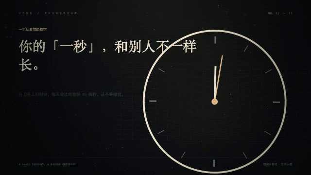
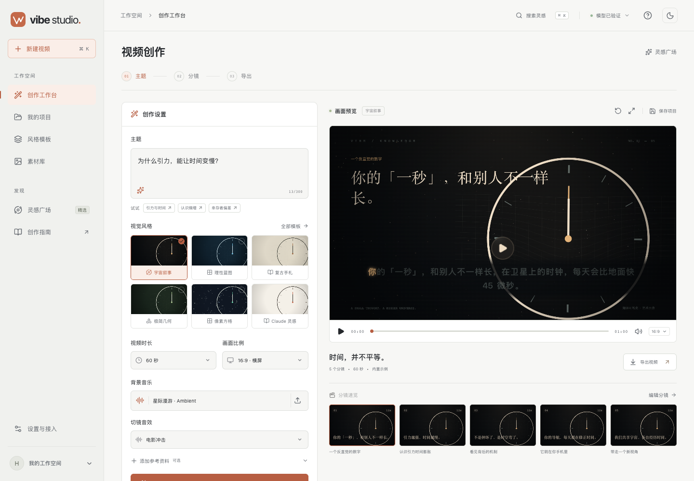
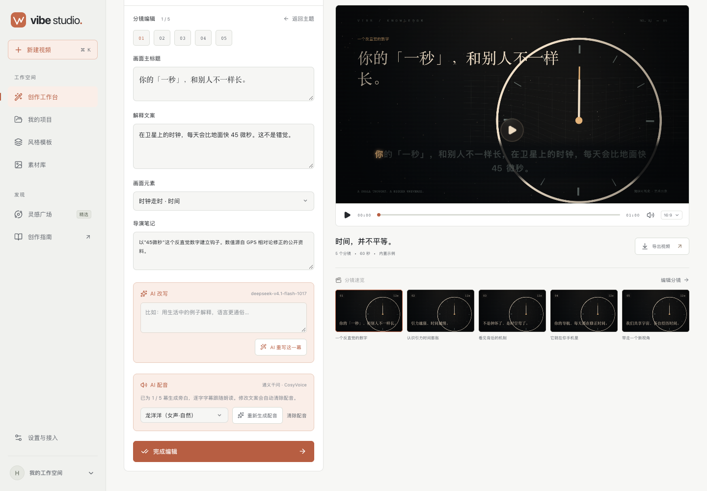
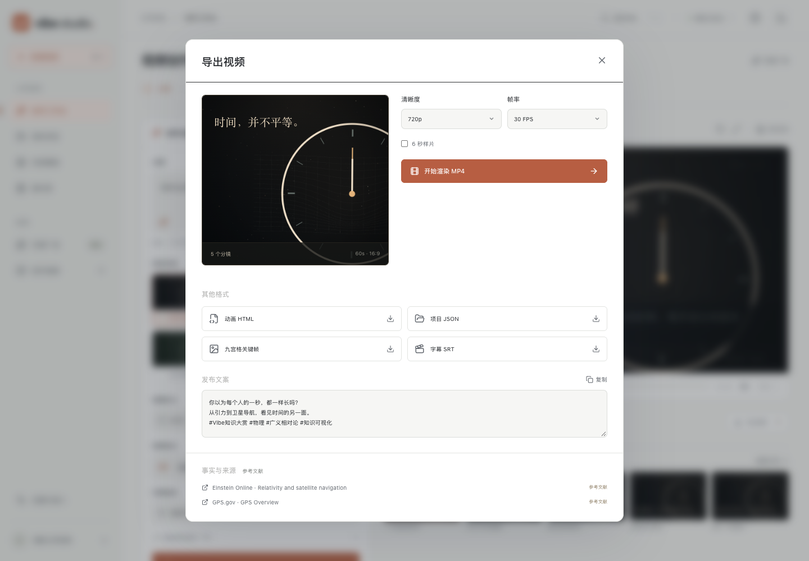
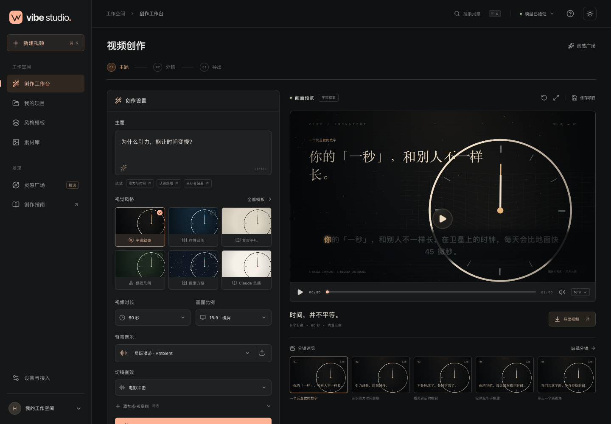
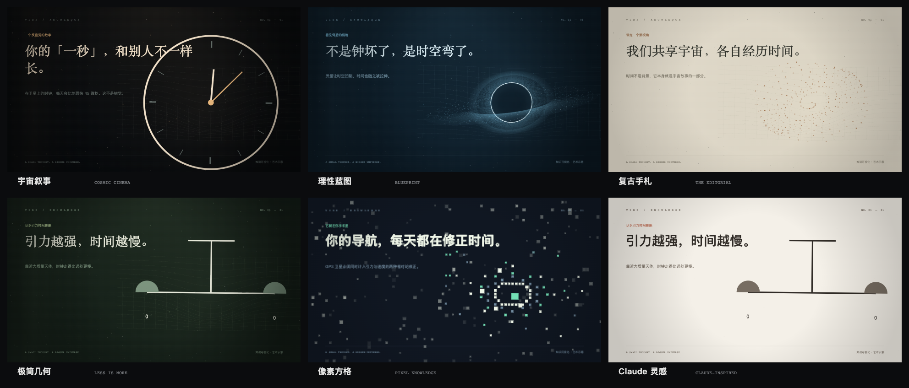
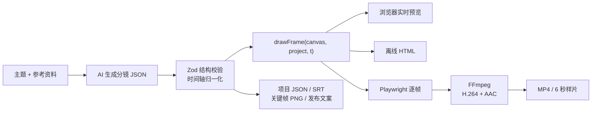

<div align="center">


# Vibe Studio

**把一个好问题，变成可以预览、编辑、导出的知识动画。**

输入一个主题，AI 产出分镜；在浏览器里改文案、换风格、听配音、拖时间轴；最后导出带音乐和音效的 MP4。

[](https://github.com/iihao/vibe-video/actions/workflows/ci.yml)
[](LICENSE)
[](package.json)
[](CONTRIBUTING.md)

[快速开始](#快速开始) · [功能](#能做什么) · [界面](#界面) · [工作原理](#工作原理) · [接入模型](#接入模型) · [Roadmap](#roadmap)

</div>



> 上面的动图由项目自己的渲染器逐帧生成，不是剪出来的演示。预览、离线 HTML、MP4 三路画面来自同一个 `drawFrame`。
>
> [▶ 播放 6 秒成片（带背景音乐和切镜音效，1 MB）](docs/demo/sample.mp4)

---

## 这是什么

Vibe Studio 是一个**本地优先**的知识短视频工作台，面向「想把一个概念讲清楚」的创作者：

- 你给一个主题和参考资料，模型输出结构化分镜（不是视频、不是代码）。
- 分镜可以逐幕编辑：标题、解释文案、画面元素、导演笔记。
- 画面由确定性 Canvas 渲染器实时画出，预览和导出完全一致。
- 支持 AI 配音、逐字字幕、背景音乐、切镜音效，直接导出 MP4。

它不依赖云端渲染农场，不需要登录，不会把你的 API Key 发到浏览器。打开本机网页就能用。

## 能做什么

- **AI 分镜**：主题 → 结构化 JSON → 校验 → 归一化时间轴。流式展示生成过程，可取消、可单幕重写。
- **六套视觉风格**：宇宙叙事、理性蓝图、复古手札、极简几何、像素方格、Claude 灵感；全部支持 16:9 / 9:16 / 1:1。
- **22 种画面元素**：黑洞、轨道、时空网格、粒子、概念柱图，以及 K 线、饼图、公式、DNA、原子、齿轮、时钟、声波、金字塔、网络、流水线、路径、天平、地图等真正内容相关的图形。
- **确定性动画**：镜头持续推进、元素级入场、标题逐字入场、能量环转场、蓄能—静寂—爆发高潮。
- **声音**：程序合成 BGM、切镜卡点音效，支持上传自己的音乐；实验性 AI 配音与逐字高亮字幕。
- **MP4 导出**：Playwright 驱动 Canvas 逐帧绘制，JPEG 帧直接管道给 FFmpeg，输出 H.264 / AAC；支持 720p / 1080p、24 / 30 FPS、6 秒样片。
- **创作交付物**：独立离线 HTML、可重新导入的项目 JSON、九宫格关键帧 PNG、SRT 字幕、发布文案与来源。
- **本地存储**：草稿自动保存、项目列表、素材库；API Key 用 AES-256-GCM 加密落盘。

## 界面



> 左侧创作设置，右侧实时画面预览。主题、风格、时长、比例、音乐、切镜音效都在同一屏完成。



> 分镜编辑页：逐幕改文案、换画面元素；生成配音后可以一键清除，改文案会自动让旧配音失效。



> 导出面板：720p / 1080p、24 / 30 FPS、6 秒样片，以及 HTML、JSON、关键帧、SRT。

<details>
<summary>深色模式</summary>



</details>

## 六套视觉风格



每套风格不是换配色，而是独立的光影、排版、图形语言和质感层。AI 只负责选择画面元素和内容，不生成可执行代码。

## 快速开始

需要 **Node.js 22.12+**、**Chrome / Chromium** 和 **FFmpeg**。

```bash
git clone https://github.com/iihao/vibe-video.git
cd vibe-video
npm install
npm run dev
```

打开 <http://localhost:3000>。

没有 Chrome 时：

```bash
npx playwright install chromium
```

macOS 安装 FFmpeg：

```bash
brew install ffmpeg
```

### 没有 API Key 也能完整体验

1. 保留默认主题「为什么引力，能让时间变慢？」。
2. 选一套风格、时长、比例和音乐。
3. 点「生成脚本与分镜」，会载入内置五幕示例（页面会明确标记「内置示例」）。
4. 改文案、拖时间轴、导出 6 秒样片或完整 MP4。

内置示例不会伪装成 AI 生成结果；自定义主题在没有配置模型时会明确提示接入模型。

## 工作原理



核心是一个纯函数：

```js
drawFrame(canvas, project, time);
```

- 任意时刻的画面只由「项目数据 + 时间」决定，不依赖上一帧、不依赖随机数。
- 预览、离线 HTML、服务端逐帧导出共用这一份实现，所以三路画面一致。
- 模型输出只是数据，经过 Zod 校验；不会执行模型生成的 JavaScript。
- 视频渲染时每 8 帧一批，JPEG 直接写进 FFmpeg 的 stdin，不把几千张帧落盘。

### 文字、图形与节奏

- 每个分镜的 `visual` 从固定枚举里选；`art` 可以携带真实数据（饼图占比、K 线数值、公式文本等）。
- 缺少可靠数据时，量化图形会省略数值，而不是编造统计。
- 音频层按分镜时长编排节拍，让鼓点、重音和切镜落在同一条时间线上；最后一幕中点做一次「蓄能 → 静音 → 爆发」。
- 所有动画和音效都是确定性的，所以同一条项目每次导出结果相同。

## 接入模型

在页面右上角点「接入大模型」，或打开 `http://localhost:3000/?settings=1`。

支持：

| 服务商     | 协议               | 备注                   |
| ---------- | ------------------ | ---------------------- |
| DeepSeek   | Chat Completions   | 官方 API               |
| 通义千问   | Chat Completions   | 阿里云百炼             |
| OpenAI     | Responses          | 模型列表取决于账户权限 |
| Claude     | Anthropic Messages | 模型列表取决于账户权限 |
| 自定义接口 | Chat Completions   | 兼容网关 / 私有部署    |
| Ollama     | Chat Completions   | 本地模型，无需密钥     |

配置流程：选择服务商 → 填服务地址和 API Key → 获取模型列表（或手填 Model ID）→ **测试并启用**。测试会实际调用一次模型，失败不会覆盖当前可用配置。

- 网页保存的配置优先于 `.env`；配置立即生效，无需重启。
- API Key 使用 AES-256-GCM 加密保存在 `.data/private/ai.json`，主密钥在 `.data/private/master.key`，文件权限 `0600`。
- 已保存的 Key 不会返回浏览器；留空表示复用同地址的旧 Key。
- 这是本机静态加密，不能防御已经取得本机账户权限的访问。

也支持环境变量启动：

```dotenv
AI_API_KEY=你的密钥
AI_BASE_URL=https://api.deepseek.com
AI_MODEL=deepseek-flash
AI_PROVIDER=deepseek
AI_PROTOCOL=chat
PORT=3000
```

### AI 配音（实验性）

配音目前只对接**通义千问 DashScope CosyVoice**：

1. 配置通义千问并启用。
2. 在阿里云百炼控制台开通语音合成。
3. 进入「分镜」编辑页，在「AI 配音」里选音色并生成。

实现细节：

- 文案为 `title + subtitle`，会自动去掉句末重复标点。
- 单幕旁白超过分镜时长时，用 FFmpeg `atempo` 加速（上限 1.6x），并同步缩放逐字时间戳。
- 加速后仍放不下会明确提示，而不是静默截断。
- 修改文案、时长会清除旧配音，避免声画不同步。
- 配音文件缺失时（例如项目 JSON 被导入到另一台机器），MP4 会回退为无配音渲染，不会出现「无声的逐字字幕」。

## 导出格式

| 格式         | 内容                                   | 带音频 |
| ------------ | -------------------------------------- | ------ |
| MP4          | H.264 + AAC，720p / 1080p，24 / 30 FPS | ✅     |
| 6 秒样片     | 快速验证画面与声音                     | ✅     |
| 离线 HTML    | 单文件 Canvas 播放器，可离线打开       | ❌     |
| 项目 JSON    | 可重新导入、继续编辑                   | —      |
| 九宫格关键帧 | 3×3 画面预览 PNG                       | —      |
| SRT          | 分镜级字幕                             | —      |
| 发布文案     | 标题、话题、来源                       | —      |

`720p / 1080p` 指短边尺寸：横屏 1280×720 / 1920×1080；竖屏 720×1280 / 1080×1920；方形 720×720 / 1080×1080。

## 技术栈

- **前端**：React 19、TypeScript、Vite
- **渲染**：Canvas 2D（主渲染器）、three.js（星云 WebGL 艺术层，带 2D 回退）
- **导出**：Playwright + FFmpeg
- **服务端**：Express 5、Zod、Multer
- **音频**：程序合成 WAV + FFmpeg 混音 + Kenney CC0 音效
- **测试**：Node `node:test` + Playwright 浏览器验证

## 项目结构

```text
src/                   React + TypeScript 工作台
  App.tsx              页面、状态与创作流程
  components/          设置面板、生成过程、导出过程
  usePreviewAudio.ts   预览音轨与播放时钟
shared/
  renderer.mjs         确定性 Canvas 动画（唯一画面入口）
  figures.mjs          16 种内容相关图形
  catalog.mjs          示例、风格模板、公开案例
  sound.mjs            分镜感知音效合成
  sfx.mjs              Kenney CC0 音效与编排
  nebula-webgl.mjs     three.js 星云层（可选）
server/
  index.mjs            API、素材、导出、混音
  schema.mjs           输入与分镜结构校验
  tts.mjs              CosyVoice 配音
  ai/                  三种协议、流式输出、加密配置
tests/                 43 项单元 / 集成测试
docs/research.md       制作方法调研与实现取舍
docs/screenshots/      README 截图与动图
scripts/capture-docs.mjs  重新生成截图与动图的脚本
```

## 开发与测试

```bash
npm run check         # TypeScript 类型检查
npm test              # 43 项单元 / 集成测试
npm run format:check  # Prettier
npm run build         # 生产构建

# 需要先启动 npm run dev
npm run test:ui       # 浏览器端到端验证
npm run test:ai-ui    # 隔离的模型 + 浏览器全链路验证
npm run docs:capture  # 重新生成 README 截图与动图
```

模型集成测试使用隔离的数据目录和本机 HTTP 测试服务，不会修改个人配置，也不需要真实额度。浏览器测试会覆盖播放、比例切换、分镜修改、项目持久化、离线 HTML、移动布局和真实 MP4 输出。

## 设计取舍

- **确定性优先**：不用随机数和帧间状态，换来预览 / 导出 / 离线 HTML 一致，也方便定位问题。
- **模型只产出数据**：分镜是 JSON，画面元素从枚举里选。模型不能写代码，也不能执行代码。
- **本地优先**：没有登录、云端同步、队列或计费；数据在 `.data/` 和浏览器 localStorage 里。
- **先做可编辑的交付物**：除了 MP4，还保留项目 JSON、HTML、SRT、关键帧和发布文案，方便二次创作。
- **不假装事实核查**：AI 给出的来源统一标记「待核实」；量化图形没有可靠数据时宁可不画具体数值。

## 已知限制

- 面向本机单人创作；公开多用户部署前需要账号隔离、存储权限、配额、任务队列和限流。
- 渲染任务状态在进程内存中，服务重启后清空；已导出的文件仍在 `.data/exports/`。
- 配音只支持通义千问 CosyVoice，且按分镜逐段合成，跨幕语气不会连续。
- 离线 HTML 不内嵌音频；需要带声音的成片请用 MP4。
- AI 生成内容仍需要人工核对事实与来源。

## Roadmap

- [ ] 时间轴拖拽与多轨编辑
- [ ] 逐幕配音试听、音色/语速控制
- [ ] 更细的字幕断句与双语字幕
- [ ] 事实检索与引用校验
- [ ] Remotion 渲染适配器
- [ ] 任务持久化与多用户工作区
- [ ] 更多内容图形与转场模板

如果这个项目帮你省下了做动画的时间，欢迎点一个 ⭐️，或者提一个 issue 告诉我你想让它变成什么样。

## License

[MIT](LICENSE)

---

## English

**Vibe Studio** turns a question into a deterministic, editable knowledge animation — then exports it as MP4.

Give it a topic and optional references. An LLM returns a structured storyboard (JSON, validated with Zod). You edit titles, captions, visuals and direction notes in the browser, then export a 720p/1080p H.264 + AAC video rendered frame-by-frame with Playwright and FFmpeg.

Highlights:

- One pure renderer — `drawFrame(canvas, project, time)` — shared by live preview, offline HTML and MP4 export.
- Six visual styles, 22 scene visuals, 16 content-aware figures (pie, candlestick, equation, DNA, clock, network, pipeline, and more).
- Cinematic camera motion, title reveals, energy-ring transitions, deterministic film grain, beat-synced sound effects.
- Optional AI voiceover (Qwen CosyVoice) with karaoke captions and automatic tempo fitting.
- Local-first: encrypted API keys, no account, no cloud rendering.
- Exports: MP4, offline HTML, project JSON, keyframe sheet, SRT, publish copy.

```bash
git clone https://github.com/iihao/vibe-video.git
cd vibe-video
npm install
npm run dev   # http://localhost:3000
```

Requirements: Node.js 22.12+, Chrome/Chromium, FFmpeg.

The built-in demo works without an API key. Model configuration is optional and stored locally with AES-256-GCM encryption.

MIT licensed.
